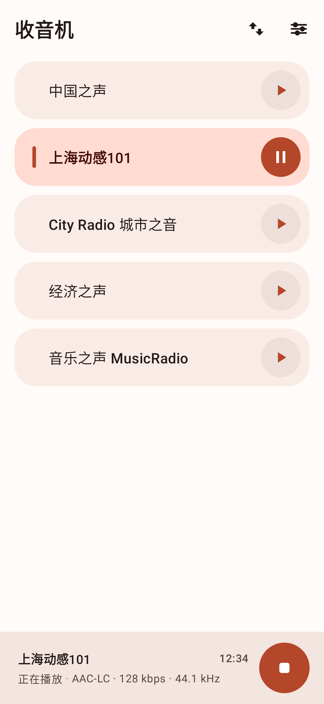
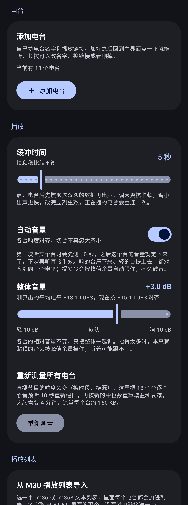

# 收音机 · Radio

一个极简的 Android 网络收音机。只有两件事：**把电台加进来**，**听**。

不注册、不登录、不推荐、不采集数据。列表里有什么，就播什么。


| 主界面 | 设置 |
| :---: | :---: |
|  |  |

## 目录

- [功能](#功能)
- [安装](#安装)
- [从源码构建](#从源码构建)
- [包体积：29 MB dex 怎么变成 3.7 MB](#包体积29-mb-dex-怎么变成-37-mb)
- [这轮代码审查修掉的问题](#这轮代码审查修掉的问题)
- [技术栈](#技术栈)
- [代码结构](#代码结构)
- [播放链路](#播放链路)
- [自动音量是怎么对齐的](#自动音量是怎么对齐的)
- [为什么播久了会停](#为什么播久了会停)
- [语音输入时为什么要停](#语音输入时为什么要停)
- [列表性能](#列表性能)
- [播放条上的两个数字](#播放条上的两个数字)
- [设置](#设置)
- [支持的链接格式](#支持的链接格式)
- [测试](#测试)
- [兼容性细节](#兼容性细节)
- [已知局限](#已知局限)
- [可以继续加的东西](#可以继续加的东西)
- [许可证](#许可证)

## 功能

**播放**

- 主界面只有一列电台名字：**点行尾的圆形按钮才播放**，点名字不会误触
- 正在播的那个台有明显标记：`primaryContainer` 底色 + 左侧竖色条 + 加粗 + 行尾变停止
- 底部常驻播放条：电台名 + **实时音质**（`AAC-LC · 128 kbps · 44.1 kHz`）+ **已播放时长**，右侧一键停止
- 播放状态挂标准 `MediaSession`：通知栏、锁屏、耳机按键都能控制；**灵动岛 / 锁屏 / 车机会显示已收听时长**，不只是一个台名
- 支持 HLS（`.m3u8`，国内电台最主流）、MP3 / AAC 直连流、RTSP

**管理**

- **长按**任意电台 → 改名字、换链接、删除
- **拖拽排序**（右上角排序图标）→ 长按任意一行拖动，松手即保存
- 设置页第一栏就是「添加电台」，填名字和链接即可；链接只写域名会自动补 `http://`
- M3U 导入 / 导出，走系统文件选择器，**不需要任何存储权限**

**音量**

- **自动音量**：每个台存一份响度档案，按它调输出电平——响的压、轻的抬，切台不再忽大忽小（可关）
- **新加 / 导入的电台入库后就在后台静音预听一遍**，第一次点它就已经是对齐的
- **一键重测**：设置里可以把所有电台重新测一遍，按最新响度重算目标电平和每台的增益
- **整体音量微调**：测出来的平均电平不一定合你的耳朵，设置里有一条滑块可以整体加减 ±10 dB，
  台与台之间仍然一样响
- 增益作用在 PCM 域，改的是送给系统的数据，和用户拖的音量条互不干扰

**细节**

- **断流自动恢复**：CDN 关掉长连接、切网、地铁进隧道，回来之后自己接上，不用重新点
- **息屏继续播**：播放期间是前台服务 + 网络唤醒锁，黑屏、锁屏、装口袋里都不会被系统冻结；
  设置页还有电池优化白名单入口，厂商 ROM 那层也能一起放行
- **语音输入时自动停止**：输入法听写、语音助手一开口（麦克风被占用），电台立刻停掉，不和用户抢话筒
- **时长不随界面重建归零**：按返回键退出界面后从胶囊点回来，播放条接着显示真实收听时长；暂停期间不计时，也不会虚增
- **停止即断流**：列表行尾和底部播放键是同一个动作 —— 点一下停止（断开连接、清空缓冲），再点重新拉流、从当前直播位置开始；不会出现「这个按钮重连、那个按钮接着放旧内容」
- 背景色跟随系统主题：Android 12+ 取壁纸配色（Material You），深色 / 浅色随系统切换
- 自适应图标：紫 → 青渐变 + 白色广播信号符号，支持 Android 13+ 主题图标单色模式
- 平板自适应：列表和设置页最宽 720dp 居中

## 安装

**直接用**

到 [Releases](../../releases) 下载最新的 `RadioApp-x.y-release.apk`（当前版本 **3.2**，versionCode 23），传到手机上安装。

- 需要 Android 8.0（API 26）及以上
- 首次播放会请求通知权限（Android 13+），用于通知栏 / 锁屏控制
- 如果之前装过旧版本，可以直接覆盖安装，**电台列表不会丢**——release 包一直用同一个证书签名

**自己构建** 见下一节。

## 从源码构建

| 项目 | 版本 |
| --- | --- |
| Kotlin | 2.3.21 |
| Android Gradle Plugin | 8.13.2 |
| Gradle | 8.14.3 |
| compileSdk / targetSdk | **37（Android 17）** |
| minSdk | 26（Android 8.0） |
| JDK | 17 |
| 播放内核 | Media3 ExoPlayer 1.11.1 + HLS / RTSP 模块 |
| UI | Jetpack Compose + Material 3 |

**Android Studio（推荐）**

1. `File → Open`，选中仓库根目录
2. 等 Gradle 同步完成（首次会下载依赖）
3. 连上手机，点 Run

**命令行**

```bash
./gradlew assembleDebug
# 产物：app/build/outputs/apk/debug/app-debug.apk
adb install -r app/build/outputs/apk/debug/app-debug.apk
```

**Release 包**

```bash
./gradlew assembleRelease
# 产物：app/build/outputs/apk/release/app-release.apk
```

> `local.properties` 里的 `sdk.dir` 是本机 SDK 路径，Android Studio 会自动生成；命令行构建报找不到 SDK 时，改成自己的路径。

> `gradle/wrapper/gradle-wrapper.properties` 里的下载地址换成了腾讯云镜像，国内同步快很多。海外环境可以改回 `https://services.gradle.org/distributions/`。

**自动构建（GitHub Actions）**

仓库带了 `.github/workflows/android.yml`，不需要任何配置就能跑：

- **触发**：push 到 `main` / `master`、发起 PR，或在 Actions 页面手动 `Run workflow`
- **做什么**：Ubuntu + JDK 17 + Android SDK 37，执行 `./gradlew assembleDebug`
- **拿产物**：Actions → 某次运行 → 页面底部 **Artifacts** → `radio-debug-<构建号>.zip`，里面是 `app-debug.apk`，保留 14 天

几个细节：

- **不需要 secret**：debug 包由 runner 本地生成的调试证书签名，装上就能用
- **有缓存**：Gradle 依赖和 wrapper 都走 `gradle/actions/setup-gradle` 的缓存，首次约 5 分钟，之后 1–2 分钟
- **会自动取消**：同一分支连续 push，前一次还在跑的构建直接取消，不浪费额度
- **只构建 debug**：release 包涉及签名私钥，不适合放在公开仓库的 CI 里，仍在本地发（见下节）

> 默认不跑单元测试。想在 CI 里一起跑，把构建命令换成 `./gradlew assembleDebug testDebugUnitTest`（Robolectric 用例较重，构建时间会翻倍）。

**关于签名。** 这个工程的 `release` 用的是 **debug 证书**（见 `app/build.gradle.kts`），目的是让 release 包和之前装的包同签名、能直接覆盖升级。如果你要自己发布，请换成正式 keystore：

```kotlin
signingConfigs {
    create("release") {
        storeFile = file("your.keystore")
        storePassword = System.getenv("KEYSTORE_PASSWORD")
        keyAlias = "radio"
        keyPassword = System.getenv("KEY_PASSWORD")
    }
}
buildTypes { getByName("release") { signingConfig = signingConfigs.getByName("release") } }
```

> 为什么非要发 release 包：`debuggable=true` 的 APK 在 ART 上不做 AOT 预编译、JIT 也受限，Compose 列表滚动会明显发肉。同样的代码，release 包顺畅得多。

## 包体积：29 MB dex 怎么变成 3.7 MB

不混淆的时候，这个工程的 dex 有 **29 MB**（13.8 + 9.5 + 5.7，三个 dex 文件），APK **11.3 MB**。功能一行没少，现在 dex 是 **3.7 MB**，APK **2.0 MB**：

| | 3.1 | 3.2 |
|---|---|---|
| APK | 11.3 MB | **2.0 MB** |
| dex 原始大小 | 29.0 MB（3 个） | **3.7 MB（1 个）** |
| dex 方法数 | 超过单 dex 上限，被迫分包 | 单 dex 装得下 |
| 资源 | 全语言 | 只留 `zh` / `en` |

三件事，缺一不可：

```kotlin
buildTypes {
    release {
        isMinifyEnabled = true      // R8：删掉没执行的类、方法、字段，并重命名
        isShrinkResources = true    // 删掉只有被删代码才引用的资源
        proguardFiles(getDefaultProguardFile("proguard-android-optimize.txt"), "proguard-rules.pro")
    }
}
androidResources { localeFilters += listOf("zh", "en") }
```

- **R8** 是主力。Media3 + Compose 的 jar 里绝大多数代码这辈子都不会执行（各家 DRM、Cast、Leanback、所有非 HTTP 的 DataSource），删掉之后 dex 直接少了八成多。
- **shrinkResources** 跟着 R8 的结果走：`values-xx/strings.xml`、没有引用的 drawable 一并清掉。它不会误删运行时按名字取的资源——那样会编译报错并提示你加 `tools:keep`。
- **localeFilters** 只保留中英。Material 组件自带几十种语言的文案，一个中文 App 留着纯属浪费。

代价是必须告诉 R8「哪些东西是反射用的」。Media3 通过 `MimeTypes` 反射构造 `HlsMediaSource$Factory` / `RtspMediaSource$Factory`，这些类名一改，m3u8 和 rtsp 链接会直接播不出来，而且**不报错**，只是黑着屏等缓冲。所以 `proguard-rules.pro` 里显式保留了它们，以及 `MediaSession`、`Service` 子类和 Compose 的运行时反射入口。

验证方式是看产物而不是猜：`app/build/outputs/mapping/release/mapping.txt` 里能查到 `Mp3Extractor -> c6.d`、`TsExtractor -> q6.e0`（被改名但留下了），`usage.txt` 里能看到具体删掉了哪些成员；装到机器上再逐个格式放一遍，才算过关。

## 这轮代码审查修掉的问题

打包之前把播放链路从头到尾读了一遍，找到几处「平时不发作、发作了很难查」的东西：

| 位置 | 问题 | 处理 |
|---|---|---|
| `PlaybackEngine.player()` | 先判断「旧实例能用吗」，后来改成先清 `currentReleased` 再判断，条件就永远为真。缓冲档位切换时会把已释放的播放器当成活的，去做状态搬迁——界面高亮了、声音还在上一个台 | 进函数第一行就把 `existingUsable` 快照下来，重建后不再回头看标志位 |
| `PlaybackEngine.release()` | 字段清空和 `existing!!.release()` 混着写，`release()` 被并发调用时会 NPE | 统一成 `existing?.release()` 包在 `runCatching` 里，清字段在前、释放在后 |
| `PlaybackService` | 曾加过一个 15 秒自我重排的 `tickTask` 用来刷新通知进度，等同于永不停止的定时器，测试里直接把 Robolectric 的 looper 跑死 | 删掉。通知进度由 `SessionPlayer` 的 position 提供，不需要自己 tick |
| `StationMeasureQueue` | 重算 `total` 的分支写了两遍，改一处漏一处，进度条会从 0 重跳 | 合并成一条路径 |
| `RadioScreen` | 拖拽排序时 `working` 列表和 `stations` 的同步顺序不对，快速连续拖动会丢一位 | 以 `working` 为唯一真源，落定后再回写 |
| 单元测试 | 进程级播放器没在用例间释放，前一个类的 ExoPlayer 残留，`playback` 线程 `unregisterReceiver` 抛异常后整轮卡死 | 每个测试类 `@After` 调 `PlaybackEngine.release()` + 清 `PlayedTime` |

## 技术栈

- **UI**：Jetpack Compose + Material 3，单 Activity，无 Fragment、无导航库
- **播放**：Media3 ExoPlayer，普通 `Service` 常驻前台 + 独立 `MediaSession`
- **状态**：`ViewModel` + `StateFlow`，存储用 `SharedPreferences` + 手写 JSON（不引 Room，几十个电台用不上）
- **音频处理**：自定义 `AudioProcessor`（BS.1770 响度计 + PCM 增益）
- **架构**：无 DI 框架，`PlaybackEngine` 是进程级单例，界面与播放器直连

## 代码结构

```
.github/workflows/android.yml   CI：push / PR 自动构建 debug APK
docs/images/                    README 用的截图

app/src/main/java/com/radio/simple/
├── MainActivity.kt                 入口，套主题
├── data/
│   ├── Station.kt                  电台数据类 + 链接规范化 + 去重用的 key
│   ├── StationStore.kt             电台存储（SharedPreferences + JSON），含批量导入
│   ├── RadioSettings.kt            设置数据类 + 设置存储
│   ├── M3uParser.kt                M3U 文本解析（纯函数，好测）
│   ├── M3uImporter.kt              读 Uri、解码（UTF-8 / GBK）、限大小
│   └── M3uExporter.kt              生成 M3U 文本 + 写 Uri
├── playback/
│   ├── PlaybackEngine.kt           进程内唯一播放器（界面直连，缓冲参数热切换）
│   ├── AudioQuality.kt             把音轨格式翻成「AAC-LC · 128 kbps · 44.1 kHz」
│   ├── LoudnessMeter.kt            音频链里的响度计（BS.1770，只测不改）
│   ├── LoudnessProbe.kt            新电台的静音预听（单独一个不抢焦点的播放器）
│   ├── StationMeasureQueue.kt      预听队列（串行、去重、失败不重试）
│   ├── GainProcessor.kt            PCM 域增益（可压可抬，内部渐变）
│   ├── VolumeLevel.kt              响度 + 峰值 → 增益（双向对齐规则）
│   ├── StreamMime.kt               从地址猜 m3u8 / mpd
│   ├── RadioLoadErrorPolicy.kt     直播流重试策略（按错误类型区分）
│   ├── VoiceInputWatcher.kt        监听麦克风占用，语音输入时停播
│   ├── SessionPlayer.kt            给 MediaSession 的包装层（直播伪装成有时长，时长才显示得出来）
│   └── PlaybackService.kt          前台服务 + MediaSession（通知栏 / 锁屏 / 灵动岛）
└── ui/
    ├── PlayerViewModel.kt          列表状态 + 播放控制 + 导入
    ├── RadioScreen.kt              主界面（列表 / 空状态 / 长按编辑 / 删除确认 / 页面切换）
    ├── SettingsScreen.kt           设置页（添加电台 + 缓冲 + 自动音量 + 后台保护 + 导入 / 导出）
    ├── Reorder.kt                  拖拽排序的一步计算（纯函数）
    ├── StationEditorDialog.kt      添加与编辑对话框
    ├── Icons.kt                    自己画的图标
    └── theme/Theme.kt              动态取色 + 深浅色
```

`RadioScreen` 只负责接 ViewModel，真正的界面在 `RadioContent`——纯参数、不依赖 ViewModel，方便做 `@Preview` 和界面测试。

## 播放链路

播放器是 `PlaybackEngine` 里的进程级单例，点电台是同步的 `setMediaItem + prepare + play`，一步到底。

**一条硬规则：任何地方都不缓存 `ExoPlayer` 引用。** 缓冲时长变化会重建播放器并释放旧实例，而被释放的 ExoPlayer 对 `setMediaItem / play` 是「静默忽略」的——不抛异常、不打日志，结果就是界面高亮了、声音还是上一个电台。所以：

- `PlayerViewModel` 每次操作都通过 `PlaybackEngine.player()` 现取现用
- 重建时先把界面和 `MediaSession` 都换到新实例，**最后**才释放旧的
- `setMediaItem` 之后回读 `currentMediaItem.mediaId` 校验，没换过去就明确提示，而不是假装在播

`MediaSession` 仍然挂在同一个播放器上（`PlaybackService` 负责），所以：

- 通知栏 / 锁屏 / 蓝牙耳机按键照常工作
- ColorOS 17 的灵动岛（流体云）读的就是这个 MediaSession，标题、副标题、封面都来自 `MediaMetadata`，点击胶囊打开应用（`setSessionActivity`）
- 改缓冲时长会重建播放器，`MediaSession.setPlayer()` 把会话换到新实例，通知不断线

## 自动音量是怎么对齐的

### 插在哪

ExoPlayer 的音频输出是 `解码 → AudioProcessor 链 → AudioTrack → 系统混音`。链上挂了两个处理器，顺序不能换：

```
解码 ──▶ LoudnessMeter ──▶ GainProcessor ──▶ AudioTrack ──▶ 系统混音
          （只读，测响度+峰值）  （乘增益，可压可抬）
```

响度计必须在增益**之前**：否则它测到的是「已经调过音量」的信号，增益会越算越偏，最后自己追着自己跑。两者都在 `AudioTrack` 之前，改的是送给系统的 PCM 数据，和用户拖的音量条（`STREAM_MUSIC`）完全是两条路。

顺带一提：`ExoPlayer.setVolume()` 现在不用了。那个接口只能 0–1，和这里的增益会相乘，两处一起改必然乱。

### 测什么

ITU-R BS.1770 的积分响度，外加一个峰值：

1. K 加权：高搁架（+4 dB @ 1681 Hz，模拟头部效应）+ 38 Hz 高通（去掉听不见的次声能量）
2. 每 400 ms 一个 block，算该段均方能量
3. 绝对门限 −70 LUFS（剔静音）+ 相对门限 −10 LU（剔掉明显偏轻的段落）
4. 通过门限的 block 取平均，`−0.691 + 10·log10(能量)` 就是积分响度
5. 同时记下这段时间的**采样峰值**（不过滤波器，取原始样本的绝对值最大值）

滤波器系数按实际采样率重算，44.1k 和 48k 测出来必须是同一个数（`LoudnessMeterTest` 卡了这条）。

### 怎么算增益

目标电平取所有已测台的**中位数**，再夹在 −20 ~ −16 LUFS：

```
目标 = median(所有台的 LUFS) clamped to [−20, −16]
增益 = 目标 − 本台 LUFS
      ├─ 负数（要压）：随便压，封顶 −15 dB
      └─ 正数（要抬）：再受峰值限制，见下
```

为什么是中位数而不是最轻的台：那是最早「只能压」时的做法，靠牺牲整体音量换取一致性。现在能抬了，向中间看齐可以让整体音量基本不变，只把两头的差异收拢。

只有一个台测过时没有中位数可言，这时**以那台为参照**（`VolumeLevel.anchor`）——刚装好、刚加第二台的时候，用户耳朵里已经有了「正常音量」的基准，新台朝它对齐是对的。如果一个都没测过，就什么都不做。

### 为什么放大要看峰值

积分响度只说明「平均多响」。一个平均很轻但偶尔冒尖的源，按平均值抬几 dB 就会削顶。所以正增益卡在 `−3 dBFS − 采样峰值` 以内，余量不够就少抬，一点余量都没有（源自己已经削顶）就干脆不抬。

> 为什么是 −3 而不是 −1：实测香港电台第一台的**采样峰值**是 −10.2 dBFS，但**真峰值**（inter-sample peak）是 −7.0 dBFS，差 3.2 dB。高频丰富的语音经过有损编码后，采样点之间的波形会鼓出去。我们测的是采样峰值（便宜、够用），所以必须多留这 3 dB，否则抬完听着「没爆表」，其实已经顶穿了 DAC 的重建波形。

### 实测效果

拿 18 个真实电台流（中国之声、央广网系列、喜马拉雅、蜻蜓、香港新城、香港电台）各抓 25 秒测出来的结果：

| | 对齐前 | 对齐后 |
|---|---|---|
| 最响 | −10.6 LUFS（新城采讯） | −18.1 |
| 最轻 | −21.8 LUFS（香港电台第二台） | −18.1 |
| 跨度 | **11.2 dB** | **0** |

最轻的那台只需要抬 3.7 dB，而它的峰值余量有 7.9 dB，绰绰有余；全部 18 个台的输出峰值都落在 −4 dBFS 以下，一个都没被天花板卡住。

另外，同台内 25 秒窗口的 LRA 全部 ≤ 5.7 LU（多数 1–3），说明**不需要**做实时 AGC：节目内部的响度本来就是稳的，差异主要在台与台之间。

### 新加的电台为什么也能对齐

「切台忽大忽小」这个毛病，在新加的台上最容易复现：档案是听出来的，没听过就没有。只靠「播放时测」的话，第一次听一个新台，前 10 秒只能按原样播 —— 如果它正好是个很响的源，切过去那一下照样炸。所以做了两层：

**第一层：入库即预听。** 加台、导入、换链接之后，立刻在后台起一个**独立**的播放器，`volume = 0`、不抢音频焦点，把流拉 10 秒量出响度和峰值写进档案。独立的意思是：不干扰正在播的那个台（不打断、不抢焦点），也不走增益链（量的是源本身的电平）。等用户真去点它时，它和听过的老台没有任何区别。

**第二层：兜底的冷启动。** 预听没成功（连不上、超时、用户刚加就点播）时，播放中的测量会在 2.4 秒就给出第一版增益，先按 −8 / +3 dB 的收窄范围把电平拉回来，10 秒后再换成正式值。期间变化小于 1.5 dB 就不动，避免前几秒音量一点点往上爬。

```
预听（后台静音 10s） ──▶ 档案 ──▶ 点播时第一声就对齐
        │
        └─ 失败 ──▶ 播放中测量：2.4s 粗对 ──▶ 10s 正式对齐
```

### 什么时候会失效

- 换掉某个台的链接 → 旧档案作废（另一个流，另一个电平），重新排进预听队列
- 只改名字 → 档案保留
- 新增一个更轻 / 更响的台 → 它的档案会让中位数挪一点，正在播的台当场跟着重新对齐，不用等下次切台
- 关掉开关 → 增益回到 1.0，完全按原始电平播
- **直播节目本身在变** → 档案是「那 10 秒」的平均值。同一批电台隔 1 小时重测，多数台只差 ±1.5 dB，但香港一台差了 5 dB（深夜谈话节目和白天节目本身就不是一个响度）。这类台会按第一次测到的值固定下来，可能偏轻或偏响几 dB —— 它反映的是「测的那一刻」，不是全天平均

预听也有代价：每个新台要静音拉 10 秒流（约 160 KB），导入 15 个台就是一串 2 分半钟、2 MB 出头的后台流量。所以它是**串行**的，用户关掉自动音量会立刻停下；连不上的台试一次就放弃，不会反复烧流量。

## 语音输入时为什么要停

**音频焦点管不了这件事。** 音频焦点解决的是「两个 App 同时出声」，谁抢到谁响。语音输入走的是**麦克风**：输入法听写、语音助手开始录音时，系统并不会让正在播的 App 让路，于是喇叭的声音被一起收进去，识别率掉下来，用户还得自己按暂停。

所以这里听的是另一个信号：`AudioManager.AudioRecordingCallback`。只要有 App 开始 / 结束录音，系统就会回调。普通应用拿到的是**匿名化**的配置（看不到包名），但「几路录音、录音源是什么」还在 —— 判断语音输入够用，也不需要知道是谁，更不需要 `RECORD_AUDIO` 权限。

两个必要的克制：

- **只认「新出现」的**。启动时先把当前正在录音的会话记成基线。常驻热词、通话、无障碍这类应用可能长期占着麦克风，见到就停的话，用户一按播放就会被停掉。之后只有「多出来一路」才算刚开始说话；数量不变但会话换了（上一路结束、下一路开始）同样算
- **只认语音类的录音源**（`MIC` / `VOICE_RECOGNITION` / `VOICE_COMMUNICATION` / `DEFAULT` 等），内录、`REMOTE_SUBMIX` 不打断电台。`HOTWORD` 故意不算：那玩意儿常年开着

停下来用 `stop()` 而不是 `pause()`：语音输入结束后不该自己又响起来，要不要继续听由用户决定。底部条会显示「已停止」、计时清零 —— 和用户手按停止完全一样。

## 列表性能

电台多了以后（十几二十个）滚动 / 拖动的手感，主要取决于三件小事：

- **每行少一个图层**。行背景用 `Modifier.background(color, shape)` 画圆角，而不是 `clip(shape)` + `background` —— 后者会给每一行套一个 `graphicsLayer`，十几行一起滚就是十几张离屏图层。行本身也不再挂整行的水波纹（`indication = null`），本来就没有点击动作
- **只保留淡入淡出，关掉位移动画**。`Modifier.animateItem(placementSpec = null)`：列表增删时逐行跑 placement 动画是很贵的，淡入淡出够用了
- **固定滚动位置**。`LazyListState` 提到页面切换的外面，去设置页再回来、进出排序模式，位置都还在；列表项也标了 `contentType`，滚动时复用更省事

排序模式下只有**正在拖的那一行**才挂 `graphicsLayer` 和 `zIndex`，其余行什么都不加。

## 为什么播久了会停

「连着放十来分钟，自己就停了」——这类反馈通常不是播放器坏了，而是**流的另一端先把连接关了**。

拿一个真实电台（喜马拉雅 `live/247/64.m3u8?transcode=ts`）做了两组测量：

| 测量方式 | 结果 |
| --- | --- |
| 每 30 秒重新拉一次清单（curl，新连接） | 连续 8 分钟全部 `200`，`MEDIA-SEQUENCE` 正常递增，没有 `ENDLIST` |
| 同一个连接连续拉 12 分钟（ffmpeg） | **第 8 分 39 秒**报 `Error reading HTTP response: End of file`，之后不再有数据 |

也就是说：清单和分片本身一直是好的，但 CDN 会在 8～10 分钟时**主动关掉正在下载的长连接**。
播放器这时会收到一次读失败 —— 如果能立刻在新连接上重试，用户根本察觉不到；
而 Media3 的默认策略对 HLS 只重试 3 次、每次最多等 5 秒，加起来三秒多，一失败就真的停在那儿。

这一版做了三层处理：

**第一层：按错误类型重试。** `RadioLoadErrorPolicy` 替换默认策略：

| 情况 | 重试 |
| --- | --- |
| 403（防盗链 / token 过期） | 不重试 —— 同一个地址再请求一百次还是 403 |
| 404 / 410（分片滞后上传） | 2 次 |
| 超时、连接被重置、5xx | 8 次，间隔 2s、4s…最长 15s，合计约 70 秒 |

**第二层：重新准备播放器。** 重试只解决「同一个分片再拉一次」，如果清单会话整体失效，
重试再多次也没用。所以 `onPlayerError` 之后还会自动 `prepare()` + `play()` 重新拉一次清单，
相当于换了个新会话。等待时间 2s / 6s / 15s，三次都接不上才把错误告诉用户。
直播流如果意外走到 `STATE_ENDED`（清单短暂带 `ENDLIST`、窗口被截断），同样会重新连接；
点播 m3u8 播完则正常结束，不会重连。

**第三层：息屏不许断。** ExoPlayer 默认 `WAKE_MODE_NONE`，不持有任何唤醒锁 —— 屏幕一关、
设备睡着，CPU 和网络都可能被挂起，表现同样是「播着播着停了」。现在设置
`WAKE_MODE_NETWORK`，播放期间持有 partial wake lock 和 WiFi lock，暂停 / 停止自动释放。

用户能看到的差别：断流时底部条短暂显示「正在缓冲」，Snackbar 提示一次「…正在自动重连」，
接上后继续播；只有三次都失败才显示「播放失败」。

**这类问题没法靠重连解决的情况**：链接本身带一次性 token，过期后同一个 URL 永久 403。
这时重连会被跳过（403 不重试），直接提示链接可能过期，需要重新获取地址。

**第四层：不让进程被冻结。** 唤醒锁只管「CPU 别睡」，管不了「进程别被系统收走」。黑屏后
Android 会把不可见、又没在前台运行的进程判成 cached，几分钟后直接冻结（Android 11+ 的
cached app freezer），音频线程一起停 —— 这就是「黑屏五分钟左右自动停」的真正原因。

解法是让播放期间的服务**一直是前台服务**：`startForeground()` 挂一条常驻通知，
系统就不会再把它当 cached。这里踩过 Media3 的一个坑：`MediaSessionService` 只在
「有 `MediaController` 连上来」时才发通知、才升前台（`shouldShowNotification` 第一件事
就是查已连接的 controller），而本应用界面是直接操作 ExoPlayer 的，从没建过 controller，
所以旧版本的服务一直停在「已启动但非前台」。更麻烦的是，它在没有 controller 时收到
任何播放状态更新都会走 `removeNotification()` → `stopForeground()`，把外面自己拉起的
前台身份再撤掉。因此播放服务改成了和 [Transistor](https://codeberg.org/y20k/transistor)
一样的形态：**普通 `Service` + 独立 `MediaSession` + 自己维护的通知**，
一开播就 `startForeground`，暂停也不撤（方便锁屏接着听），只有真正停止才退出前台。

最后一层是厂商 ROM 的省电策略（ColorOS / MIUI / OriginOS 等），代码绕不过去，只能在设置页
放一个「后台播放保护」按钮，把应用加进系统的电池优化白名单，再让用户自己打开
「自启动 / 允许后台运行」。

## 播放条上的两个数字

**音质**来自播放器解析出的音轨 `Format`（`Tracks` 里被选中的那条音轨），不靠链接猜：

- 编码：`AAC-LC` / `HE-AAC` / `MP3` / `Opus` / `Vorbis` / `FLAC` / `AC-3` …
- 码率只取 `averageBitrate`。`peakBitrate` 是上限，拿来当音质会虚高（峰值 320 kbps 的流平均可能只有 128），所以干脆不显示；直播流没给码率时也不硬凑
- 采样率：`44.1 kHz`、`48 kHz` 这种

**已播放时长**是「这一次听了多久」，不是直播流的播放进度（直播没有进度可言）。累计值放在进程级的 `PlayedTime` 里、由播放器的常驻监听驱动（不是 ViewModel）：暂停、缓冲不计时，换台或停止归零；按返回键把界面销毁再从胶囊点回来，接上的是同一个数，不会从 00:00 重来，界面不在时暂停也不会虚增。界面每 0.5 秒刷一次，但只有底部条自己重组 —— `elapsedMs` 是以取值函数传进 Composable 的，列表不会跟着每秒重画。

**灵动岛 / 锁屏为什么能显示时长**：系统 UI 不读应用的通知文字，它读 `MediaSession` 对外报的播放状态。Media3 生成这份状态时先看 `isCurrentMediaItemLive()`，为真就把 position 写成「未知」、speed 写成 0 —— 直播流全是这种情况，于是所有系统界面都只能显示台名。`SessionPlayer` 这一层包装把「直播」改称「有时长的点播」：位置取 `PlayedTime` 的累计值，总时长按整点分段（0–59 分钟算第 1 段，1 小时以上算第 2 段，依此类推），同时把 duration 写进 metadata。系统拿到 `speed = 1` 后会自己往下走秒，不需要应用每秒推送。包装层只给 `MediaSession` 用，真实播放、计时、增益都还走在原来的 ExoPlayer 上。

**为什么没有「暂停」**：直播流没有进度可言，暂停期间节目一直在走；缓冲区里存的是「按下暂停那一刻起连续的一段」，直接 `play()` 会先把旧数据放完，等缓冲见底才发现 playlist 已经翻过去 —— 于是回源、断音、内容跳一截，听感就是「响几秒 → 没了 → 又响，但接不上」。所以列表行尾和底部播放键统一成**停止**：点一下 `stop()`（断开连接、清空缓冲、计时归零），再点走 `resumeFromPause()` —— 重新 `setMediaItem`（不带位置参数，落点是当前直播位置），HLS 重新取一遍 playlist。

列表行尾、底部播放键、通知栏、自动重连四个入口都走这一个方法，不会出现「这个按钮重连、那个按钮接着放旧内容」。起播位置也不再写死成 `0` —— 对直播来说 0 是窗口最开头（最旧的切片），不是最新位置。

## 设置

**添加电台**

设置页第一栏就是「添加电台」，也保留了空列表页上的引导按钮。填名字和播放链接即可，链接可以只写域名（自动补 `http://`）。

**缓冲时间（1–30 秒）**

对应 ExoPlayer 的 `DefaultLoadControl`：`bufferForPlaybackMs` 就是「攒够多久数据才出声」，同时把 `minBufferMs / maxBufferMs` 取它的两倍（最少 10 秒）作为稳定缓冲水位。数值越大越抗卡顿，越小出声越快。

改完不用重启：给 `MediaSession.setPlayer()` 换一个按新参数建好的播放器，正在播的电台会重新连一次流。服务没在跑时则等下次创建播放器时生效。

**自动音量**

开关在「播放」栏里，默认打开。原理见上文。档案从哪来，分三种情况：

| 情况 | 怎么建档 |
| --- | --- |
| 新加 / 导入 / 换链接的台 | **入库后立刻在后台静音预听 10 秒**（约 160 KB 流量），排队一个个来 |
| 正在播、但档案不全的台 | 播放链路自己测，2.4 秒先粗对一版，10 秒出正式值 |
| 老版本留下的半截档案 | 只压不抬，下次播放 / 预听时补齐峰值 |

**整体音量**

自动对齐只保证「各台一样响」，管不了「这个响度合不合你的口味」—— 同一个 −18 LUFS，
有人觉得正好，有人觉得偏轻。所以开关下面还有一条「整体音量」滑块：

- 范围 **±10 dB**，**0.5 dB** 一档，拖动时正在播的台立刻跟着变，可以边听边找位置
- 偏移加在**目标电平**上，所有台一起挪，台与台之间的相对关系完全不变
- 标题右边显示当前偏移（`+3.0 dB`），下面两行写清「测出来是多少、现在按多少对齐」
- 还没测出平均电平时滑块是灰的 —— 没有基准，加了偏移也没有意义

为什么加在目标上而不是加在每台的增益上：数学上两者等价，但加在目标上时，
「峰值余量」仍然按同一把尺子算。否则用户往上拖 3 dB，会把某个本来已经贴顶的台顶破音。

偏移本身也受单台的上限约束：往上拖到 +10 dB 时，本来就贴顶的台会被 `PEAK_CEILING_DBFS`
和 `MAX_BOOST_DB` 挡住，听着可能「跟不上」—— 这是故意的，宁可少抬一点也不破音。

**重新测量所有电台**

开关下面有一个「重新测量」按钮：把当前列表里的台**全部**重新静音预听一遍（包括已经有档案的、
正在播的），测完按新的中位数重算目标电平和每台的增益，正在播的那个台当场按新值对齐。

什么时候用它：听得久了觉得某几个台偏响 / 偏轻；换过时段的节目（深夜谈话和白天的响度不一样）；
或者刚导入一批台想一次校准到位。

- **串行**：还是排队一个个测，不会十几条流同时拉
- **有进度**：按钮位置会变成「已测 3 / 18」+ 进度条 + 当前电台名，随时可以「停止」
- **失败保留旧档案**：连不上的台不会把原来的读数清掉，只是这次不更新
- **开关关着也能测**：测完不生效，打开开关后按新档案对齐

**导入 M3U**

通过系统文件选择器（`ACTION_OPEN_DOCUMENT`）选文件，所以**不需要任何存储权限**。

- 认 `#EXTINF` 后面的名字，也认 `tvg-name` 这类带属性的写法（属性值里有逗号也不会切错）
- 没写名字的条目从链接末段推一个（`.../music_fm.mp3` → `music fm`）
- 编码先按 UTF-8 严格解，失败退回 GBK（国内不少老列表是 GBK）
- 链接重复的自动跳过：和已有电台比、文件内部也比，比较时忽略大小写、默认端口
- 选了 HLS 的 `.m3u8`（带 `#EXT-X-*`）会提示这不是电台列表，而不是导进一堆分片
- 导入后如果开着自动音量，会提示「正在后台校准音量」，免得用户奇怪为什么在跑流量

**导出 M3U**

「导出 M3U 文件」走系统保存界面（`ACTION_CREATE_DOCUMENT`），同样不需要存储权限。默认文件名带日期（`电台列表-20261119.m3u8`），编码 UTF-8。

输出就是最普通的写法，任何播放器都认：

```
#EXTM3U
#EXTINF:-1,中国之声
http://ngcdn001.cnr.cn/live/zgzs/index.m3u8
```

顺序和主界面完全一致，所以「先拖好顺序再导出」得到的就是你想要的列表。名字里的换行会被压成空格，避免一条记录被拆成两条。

**调整顺序**

点右上角的双箭头图标进入排序模式：长按任意一行拖着走，松手就落盘。拖拽期间左上角显示实时序号，底部播放条会隐藏以免误触。

算法在 `ui/Reorder.kt` 里，按「跨过几行」而不是逐像素判断换位，换位后会把已跨过的位移抵消掉 —— 不做这件事的话，被拖的行会突然跳到手指下面，手感立刻散掉。`ReorderTest` 覆盖了上移 / 下移 / 跨多行 / 顶到底 / 分帧拖动。

## 支持的链接格式

`http://`、`https://`、`rtsp://`，常见的有：

- `http://ngcdn001.cnr.cn/live/zgzs/index.m3u8?_res_tag_=audio`（HLS，国内电台最主流）
- `https://example.com/live.m3u8`（HLS）
- `http://example.com/stream.mp3`（MP3 流）
- `http://example.com:8000/stream`（Icecast / Shoutcast）

只填域名（`example.com/stream`）时会自动补成 `http://`。

**HLS 必须显式依赖 `media3-exoplayer-hls`。** Media3 的 `DefaultMediaSourceFactory` 是按 classpath 反射查找解析器的，只引入 `media3-exoplayer` 时 `.m3u8` 会直接报「不是可识别的音频流」，看起来像链接坏了，其实是客户端缺模块。`HlsSupportTest` 会守住这条：给一个带查询参数的 `.m3u8`，解析出来必须是 `HlsMediaSource`。

网络层另外做了三件事：浏览器 UA（部分 CDN 会拦非浏览器请求）、`setAllowCrossProtocolRedirects(true)`（http → https 的跳转很常见）、网络错误重试 3 次（直播流不该一次失败就报错）。

> `mms://` 和 `rtmp://` 是 Flash 时代的老协议，Media3 已不再支持。老列表里出现这类地址时，会明确提示换成 http(s) 地址，而不是笼统地报「播放失败」。

## 测试

```bash
./gradlew testDebugUnitTest
```

159 个单元测试，全部跑在 JVM 上（Robolectric + 真实音频样本），不需要真机：

- `StationStoreTest`：链接规范化（自动补 `http://`、拒绝非法地址）、增删改查 + 落盘、重排（漏掉的 / 不认识的 id 都不能让电台丢失）
- `M3uParserTest`：`#EXTINF` 名字解析（含带引号逗号、CRLF、BOM）、HLS 识别、去重 key、批量导入的「新增 / 重复 / 无效」计数 + 落盘
- `LiveResumeTest`：**每一次起播都必须重新装载媒体项**（不管停了多久、从什么状态起）、停止播放不清时长、电台被清掉才归零，以及语音抢麦时正确地清零
- `PlayedTimeTest`：只算真正出声的时间、暂停不计、重复 start 不重置起点、换台 / 停止清零，以及**界面重建后（新 ViewModel）时长必须接上原值**
- `SessionPlayerTest`：MediaSession 看到的必须**不是直播**（否则系统把 position 丢掉）、位置跟已听时长走、总时长永远大于位置、metadata 带上 duration 且不丢台名
- `PlaybackServiceTest`：播放服务能创建、播放器按缓冲档位复用 / 重建、1–30 秒每一档都能建出可用播放器；**有电台在播时必须真的 `startForeground`**，停止后要退出前台
- `StationSwitchTest`：逐个点 5 个电台，媒体项和 URI 必须逐个对上；暂停后换台仍能切；播放器被释放后能自愈重建；界面重建（换 ViewModel）不会换掉正在播的播放器
- `HlsSupportTest`：`.m3u8`（含查询参数、https、靠 MIME 提示的无扩展名地址）必须解析成 `HlsMediaSource`，普通 `.mp3` 必须仍走 `ProgressiveMediaSource`
- `M3uExporterTest`：导出文本格式、导出再导入的名字和链接必须完全一致、名字换行被压平
- `ReorderTest`：上移 / 下移 / 一次跨多行 / 顶到底钳制 / 分帧拖动与一次性拖动结果一致
- `LoudnessMeterTest`：−20 dBFS 的 1 kHz 正弦必须读成 −23.0 LUFS（单声道）/ −20.0 LUFS（立体声），44.1k 与 48k 结果一致，静音不产生假读数，`startOver()` 后彻底清零
- `VolumeLevelTest`：目标取中位数并双向钳制、用户偏移在目标上整体平移且仍受峰值 / 上限约束、放大受峰值余量限制、削顶源不放大、15 dB 衰减封顶 / 12 dB 提升封顶、只有一台已测时用它当参照、冷启动增益收窄到 −8/+3 dB，以及用真实电台数据验证「对齐后离散度 < 0.1 dB」
- `RadioLoadErrorPolicyTest`：403 不重试、404 只给两次、网络错误退避到 15 秒后放弃、
  延迟封顶，以及 HTTP 状态码能从多层 cause 里捞出来
- `SettingsStoreTest`：整体音量偏移的默认值、正负值、跨重启保留、写越界时收口、
  盘上被写坏的值读出来也要收口，以及关掉再打开自动音量不会重置偏移
- `StationMeasureQueueTest`：预听串行（同时只有一个在测）、有档案的跳过、半截档案要补测、失败 / 抛异常都不堵后面的台、同一台不排队两次、换链接后能重新排、取消后队列立刻清空
- `MicSessionTrackerTest`：常驻录音不算新输入、多出一路要认出来、会话换人不换数量要认出来、录音结束不算输入、会话 id 被匿名时靠数量兜底
- `GainProcessorTest`：16bit / float 两种格式、立体声交错、正负溢出削波、增益渐变不炸音
- `PlaybackInfoTest`：音质文案（AAC-LC / HE-AAC / MP3 / Opus、码率缺失、峰值码率不能冒充平均码率）与时长格式（`mm:ss` / `h:mm:ss`、负数归零）

## 兼容性细节

- **明文 HTTP**：大量网络电台还是 `http://` 流，Android 9+ 默认禁止，已通过 `res/xml/network_security_config.xml` 放开，否则播不了
- **Android 17 局域网权限**：`ACCESS_LOCAL_NETWORK` 是 API 37 新增的运行时权限，家里 / 公司内网自建的流媒体（如 `192.168.1.x:8000`）需要它，启动时已一并申请
- **后台播放**：普通 `Service` + `foregroundServiceType="mediaPlayback"`，播放时 `startForeground`
  挂常驻通知（MediaStyle，关联 MediaSession），锁屏、通知栏、耳机键都能控制；不再依赖
  `MediaSessionService` 的隐式时机
- **大屏**：Android 17 要求应用自适应大屏，列表和设置页在平板上最宽 720dp 居中，不会被拉成一条长线
- **音频焦点**：来电或别的 App 播放时会自动让路，拔耳机自动暂停
- **返回键**：设置页用 `BackHandler` 接管返回，也支持 Android 13+ 的预测性返回手势
- **数据存储**：全部在本地 `SharedPreferences`，应用不含任何统计 / 上报 SDK；联网只发生在拉流和 M3U 导入导出时

## 已知局限

- **测的是时间窗平均值**，遇到「广告比节目响一截」的台，切过去那一瞬间仍会有跳变。要修这个得做实时 AGC（压缩），那是会改变波形的方案，风险和收益都得重新评估
- **预听失败的台**（服务器拒绝非浏览器 UA、需要特殊鉴权）只能靠播放时的冷启动兜底，前 2.4 秒可能偏响或偏轻
- **语音输入检测依赖系统回调**。配置被匿名化后，某些机型会把会话 id 也抹成 0，这时只能靠「录音路数变多」判断；如果输入法复用了同一个录音会话（少见），这次就检测不到。个别 ROM 会拦这个回调，代码里已捕获并降级 —— 播放不受影响，只是这一项失效
- **断流恢复不是无限的**：自动重连最多 3 次（约 25 秒），之后要用户自己点。地铁长时间没信号时，回到地面仍需要手动按一下
- **厂商省电策略管不到**：前台服务能挡住系统的 cached app freezer，但 ColorOS / MIUI / OriginOS
  自己的「后台冻结 / 睡眠待机优化」是另一套，只能靠设置页那个白名单按钮 + 手动打开自启动。
  如果仍然黑屏后断，先看这一项
- **没有定时关闭、收藏分组、桌面小组件**，见下

## 可以继续加的东西

- 收藏 / 分组标签
- 定时关闭（Sleep Timer）
- 桌面小组件
- 一键联网搜索公开电台目录

## 许可证

[MIT](LICENSE) © 2026 Radio contributors

第三方依赖各自遵循其原许可证（AndroidX / Media3 为 Apache-2.0）。
